# Sentinel Core

**A self-hosted home security system with AI that actually looks at the picture, and a family
home server built around it.**

Sentinel Core runs on a computer in your house. It watches your cameras, has a vision model
(local by default, so nothing leaves your network) decide whether motion is worth waking you up
for, and tells you what happened in plain English. The same server also runs the household:
a shared calendar, reminders, notes and boards, lights, locks and a home alarm, weather radar, a
family file library with nightly backups, and your own movies, TV, music and podcasts.

Native apps for **iPhone, iPad, Mac, Apple TV, Android and Windows**, plus a web dashboard and a
wall-mounted kiosk mode, all talk to the same server.

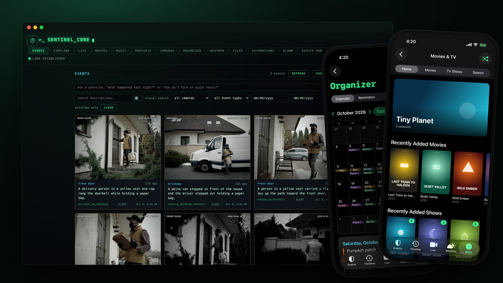

<sub>Every screenshot in this README was taken from a real running server and the real apps,
filled with demo data: invented cameras, events, family, titles and artists. The camera footage
is free stock video ([credits](docs/screenshots/CREDITS.md)).</sub>

---

## Contents

- [What it does](#what-it-does)
- [Cameras and AI alerts](#cameras-and-ai-alerts)
- [The household Organizer](#the-household-organizer)
- [Smart home: Device Hub, alarm and automations](#smart-home-device-hub-alarm-and-automations)
- [Weather](#weather)
- [Movies, TV, music and podcasts](#movies-tv-music-and-podcasts)
- [Family Files](#family-files)
- [Wall kiosk](#wall-kiosk)
- [The apps](#the-apps)
- [Running it](#running-it)
- [How it fits together](#how-it-fits-together)
- [Where things are](#where-things-are)
- [Documentation](#documentation)
- [Quick start (developer)](#quick-start-developer)

---

## What it does

| | |
|---|---|
| 🎥 **Cameras** | Live view, trigger zones, saved clips, a day timeline, PTZ, gate checks, and any phone, tablet or laptop can stream itself in as a camera |
| 🧠 **AI review** | Every motion event is judged by a vision model (Ollama locally, a cloud model, or a fast on-device detector) and described in a sentence. Faces, plates, packages and repeat arrivals are understood |
| 🔔 **Alerts** | Push to every app, email, Telegram (with a chat bot you can ask questions), Discord, MQTT, webhooks and HomeKit, with quiet hours and duplicate suppression |
| 🗓️ **Organizer** | Shared calendar, reminders, notes with checklists, and Trello-style boards with no-code automations. Works offline and syncs on every app, with widgets, Siri and voice shortcuts |
| 💡 **Smart home** | A Device Hub for MQTT lights, plugs, locks, fans, gates and garage doors; a home alarm built from your own sensors; schedules and AI-triggered automations |
| ⛅ **Weather** | National Weather Service conditions, forecast, a zoomable radar map with storm tracks, and severe-weather alerts |
| 🎬 **Media** | Your own Movies & TV and Music & Podcasts libraries (local folders or shares on other computers), streamed to every app, with optional downloads through a VPN |
| 📁 **Family Files** | A shared file library, backed up nightly to any number of drives, with duplicates weeded out |
| 🖥️ **Kiosk** | A touch-friendly wall display mode for a tablet or Raspberry Pi |
| 🛠️ **Running it** | An admin login from first launch, accounts and roles, full backup and nightly export to a folder or SFTP, self-monitoring, and signed overnight self-updates |

---

## Cameras and AI alerts

### Events: what happened, in a sentence

Motion from your cameras (or from Blue Iris, which is fully supported) goes through a queue to a
vision model. It is asked specific questions for that camera ("is the gate open?", "is a package
on the step?"), and only events it confirms reach the Events feed and your phone. You can search
them by description, search visually ("red truck"), or just ask: *"what happened last night?"*

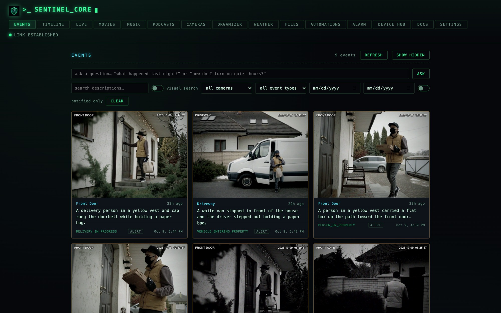

- **Three vision backends**: a local Ollama model (the default; nothing leaves the house), a
  hosted cloud model, or a fast on-device RF-DETR detector that answers in milliseconds and
  escalates to a full model only when it sees a person, vehicle or animal. Fallback between them
  is automatic.
- **Prompt profiles**: over 100 built-in instructions for different camera spots, from a front
  porch to a chicken coop, a pole barn or a boat dock.
- **Known faces and known vehicles**: local face recognition and license-plate reading, so the
  family car pulling in isn't an alert.
- **Package Theft Watch** notices when a delivered package disappears without you.
- **One arrival, not four alerts**: repeat triggers from the same visit are merged, and a
  "nuisance advisor" suggests fixes for cameras that cry wolf at night.

### Live view

Low-latency live video from every camera (WebRTC/MSE through go2rtc, with HLS as the fallback),
drag-to-arrange tiles, and on-screen pan/tilt/zoom for PTZ cameras.

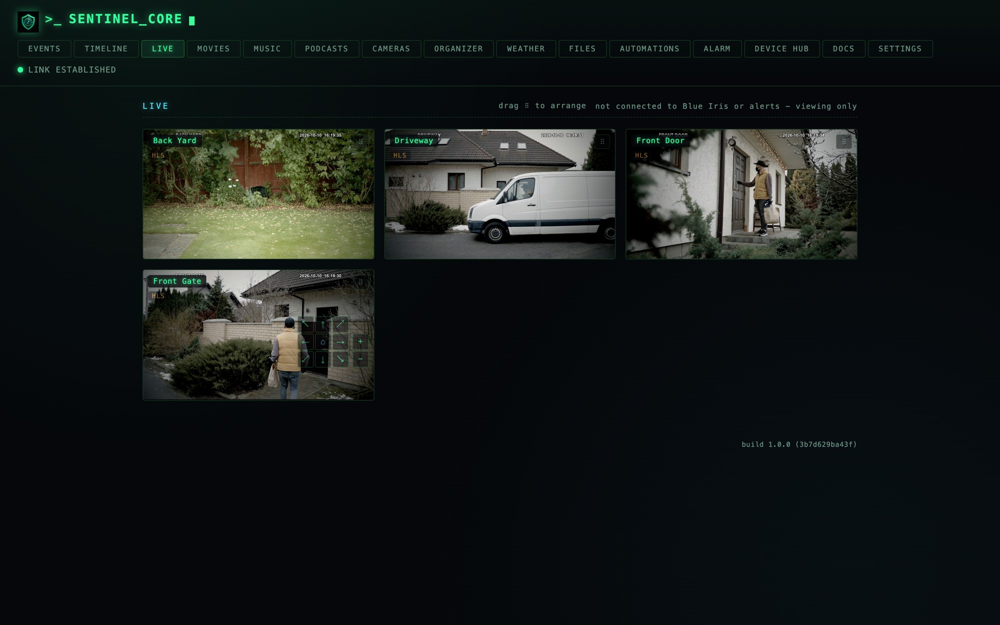

### Timeline

Scrub a whole day of saved trigger clips per camera, with the AI's events marked on the time rail
and filters for people, vehicles, animals, packages and plates.

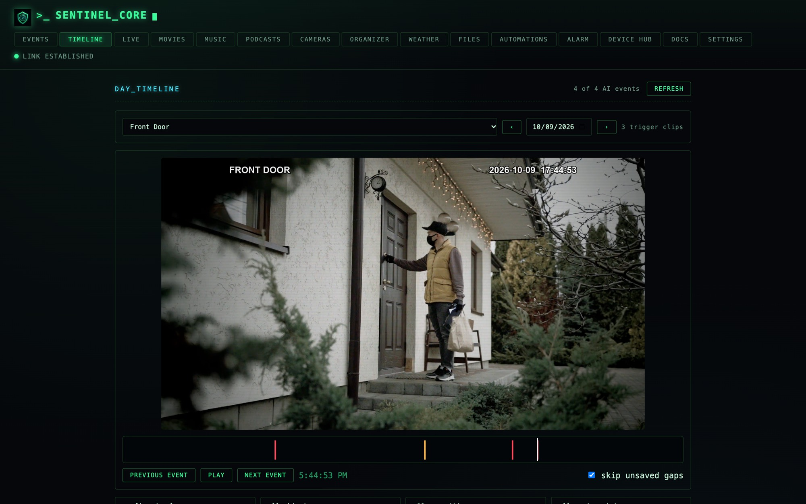

### On your phone

The same events, the AI's explanation of each one, and live video from every camera, in the
iPhone app (and the iPad, Mac, Apple TV, Android and Windows apps).

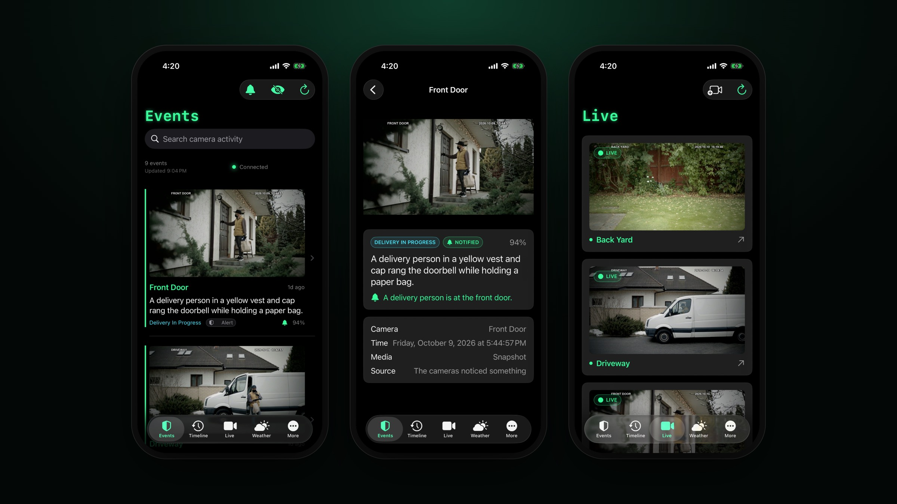

Each camera can have **trigger zones** drawn on its picture, its own motion sensitivity and clip
length, **gate checks** that periodically ask the AI whether a gate or door has been left open,
and camera **groups** so one trigger saves clips from its neighbours too.

---

## The household Organizer

A shared calendar, reminders, notes and boards for the family, synced to every app and usable
with no signal. Each app keeps its own copy and merges changes field by field, so two people
editing at once both keep their edits.

| Calendar | Boards |
|---|---|
| 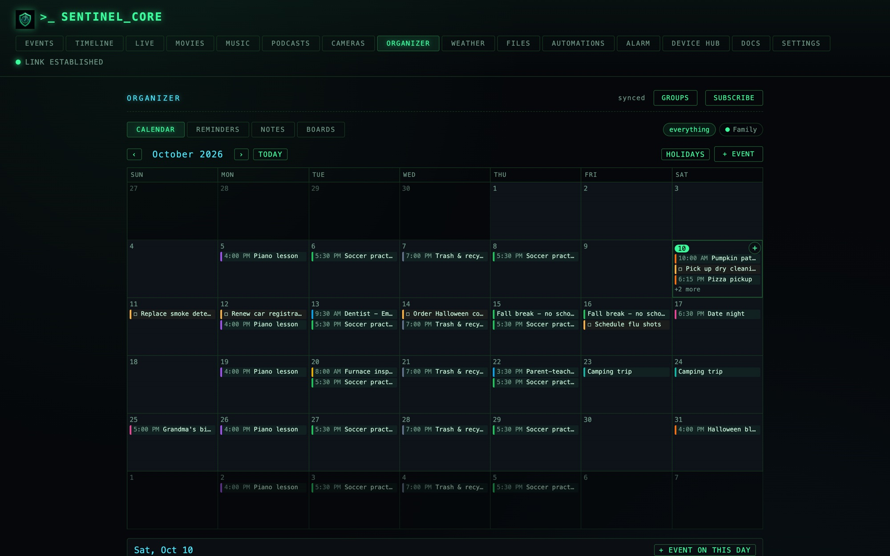 | 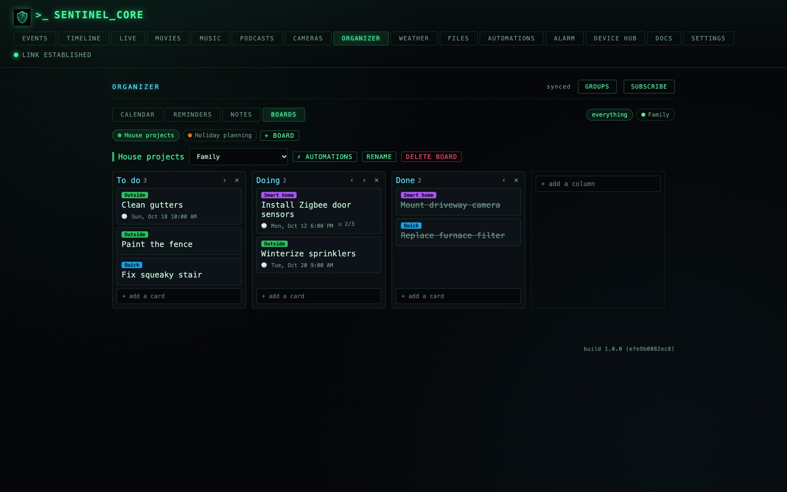 |
| **Notes with checklists** | **Reminders** |
| 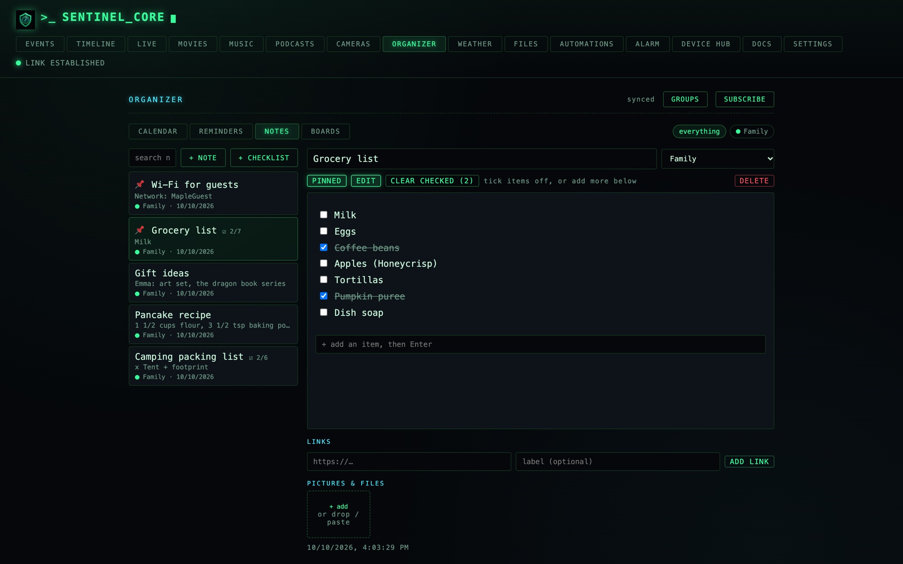 | 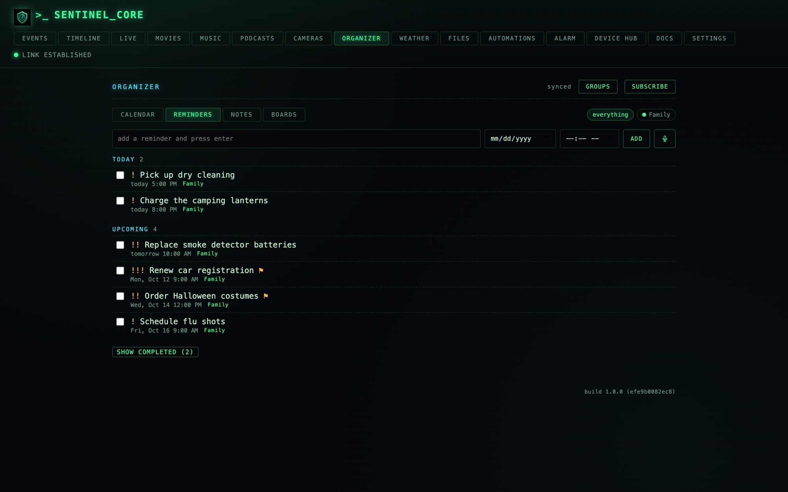 |

- **Calendar**: repeating events, all-day events, alerts, optional holiday calendars, and a
  subscribable `.ics` feed.
- **Reminders**: due dates, priorities, flags, sub-tasks, and import from Apple Reminders.
- **Notes**: Markdown with tick-off checklists, pinning, colours, links and attachments.
- **Boards**: columns, cards, labels, due dates, checklists, comments, assignees, and
  **no-code automations** ("when a card moves to Done, ...") plus scheduled cards, all run on the
  server.
- **Spaces**: everything is shared with the family, kept personal, or shared with a group.
- **Everywhere**: Home Screen widgets on iPhone and Android, a **Quick Add** widget (say or type a
  reminder, note or event), Siri and Android voice shortcuts, a share extension, and a microphone
  button on Reminders that understands "remind me Tuesday at 5 to call the dentist".

---

## Smart home: Device Hub, alarm and automations

### Device Hub

Switch and dim lights, plugs, fans, locks, gates and garage doors over MQTT. Devices are found by
Home Assistant discovery, Tasmota's own announcements or a topic sweep, and Zigbee2MQTT works out
of the box. Sensors show their readings, battery and signal. The server can run its own MQTT
broker, so nothing else is needed.

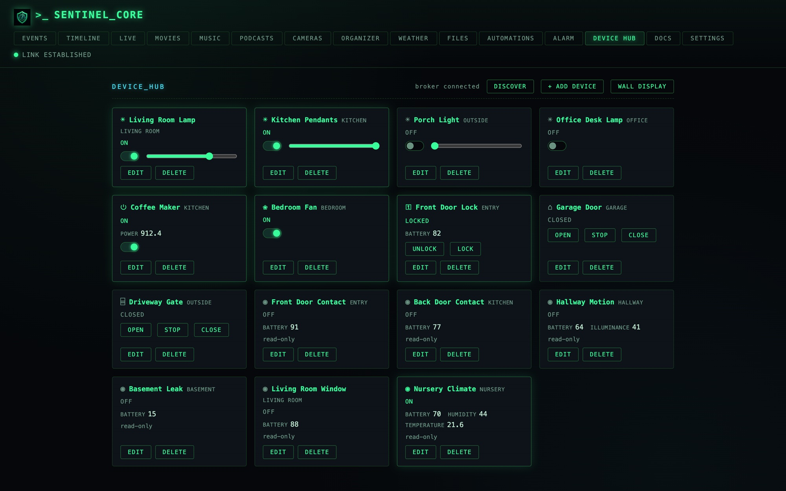

### Home alarm

Turn door contacts, window sensors, motion sensors and leak detectors into a real alarm: **Home**,
**Night** and **Away** modes, entry and exit delays, a PIN, sirens, a panic button, low-battery
and offline warnings, camera snapshots through the AI when it goes off, and push to every phone.

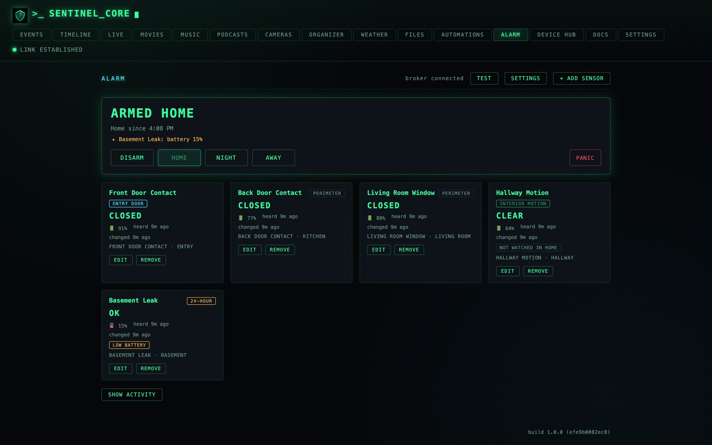

### Automations and schedules

| When something happens | At a time |
|---|---|
| 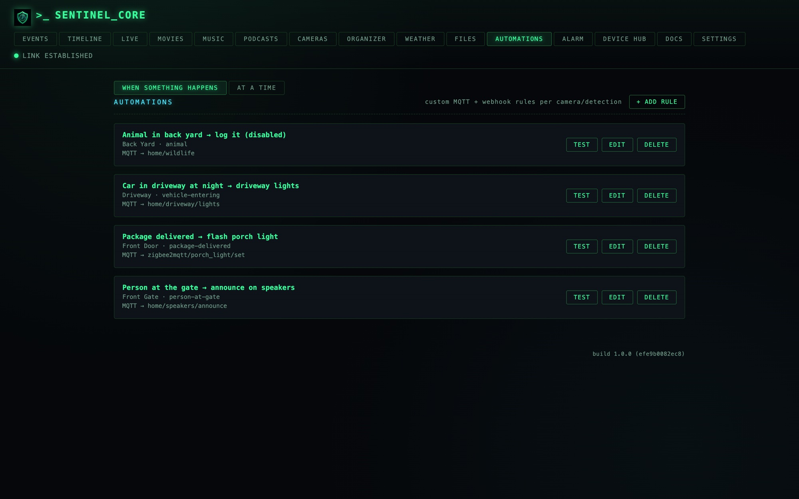 | 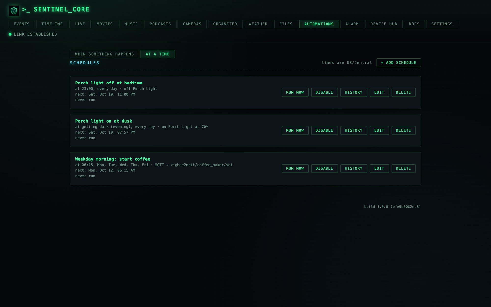 |

- **When the AI sees something**: "package delivered at the front door" or "car in the driveway
  at night" fires any MQTT message or HTTP request, with the AI's findings available as template
  tokens (`{{person_description}}`, `{{vehicle_license_plate}}` and 30 more).
- **At a time**: daily, weekly, every N minutes, cron, or at sunrise, sunset, dawn or dusk with an
  offset, switching a Device Hub device or sending MQTT or a webhook.
- **Apple HomeKit**: cameras and devices can be exposed to the Home app through a sidecar bridge.

---

## Weather

Current conditions, the hourly and seven-day forecast, the severe-weather outlook and active
alerts from the US National Weather Service, and a **zoomable radar map** with animated loops,
precipitation type, storm cell tracks and warning polygons. Severe-weather alerts can push to
every phone.

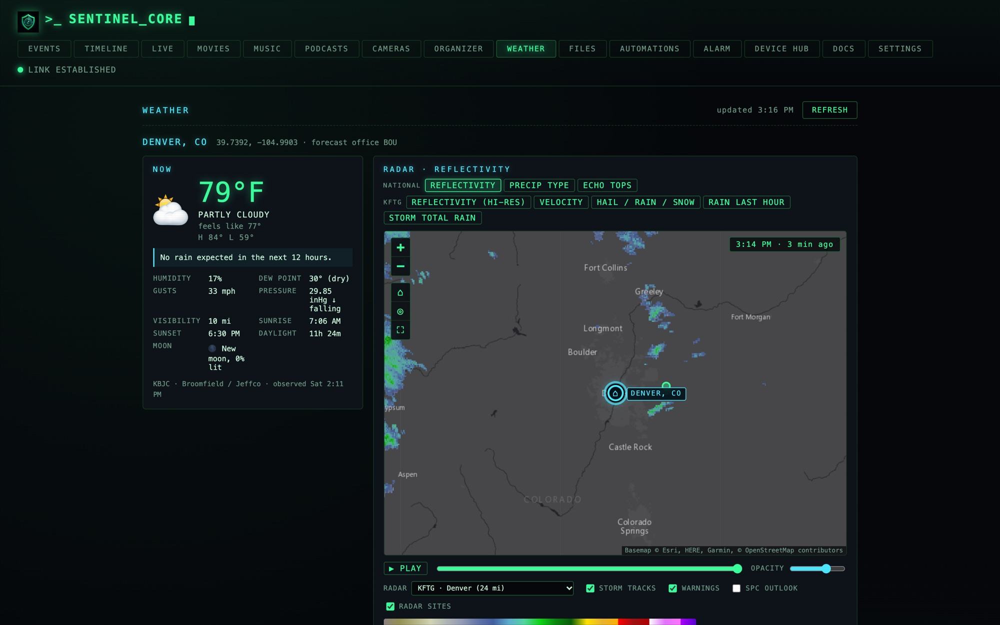

---

## Movies, TV, music and podcasts

A Jellyfin-style media server built in, played in the browser and in every app (including the
Apple TV). Libraries can be local folders or shares on another computer on the network, read
directly with no mounting.

### Movies & TV

Artwork and descriptions from TMDB (or your own `poster.jpg` files), per-person watched state and
"continue watching", My List, Surprise Me, subtitles, and optional **"+ Add" downloads** of
movies and shows through a VPN-only network namespace. Searching for something you don't have
offers to download it.

| Home | Library |
|---|---|
| 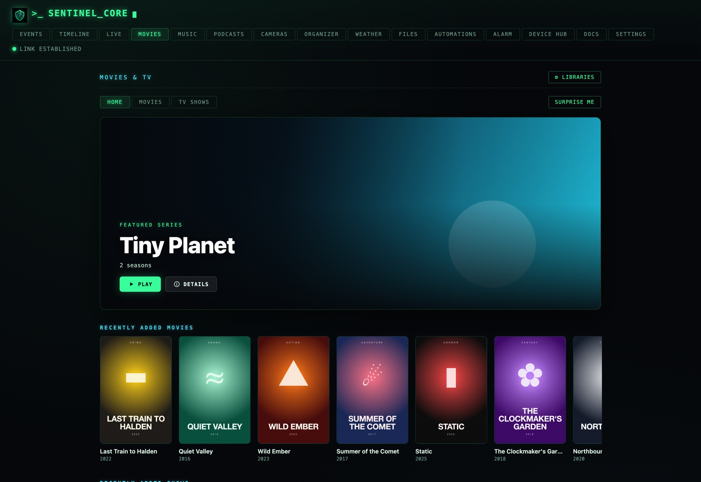 | 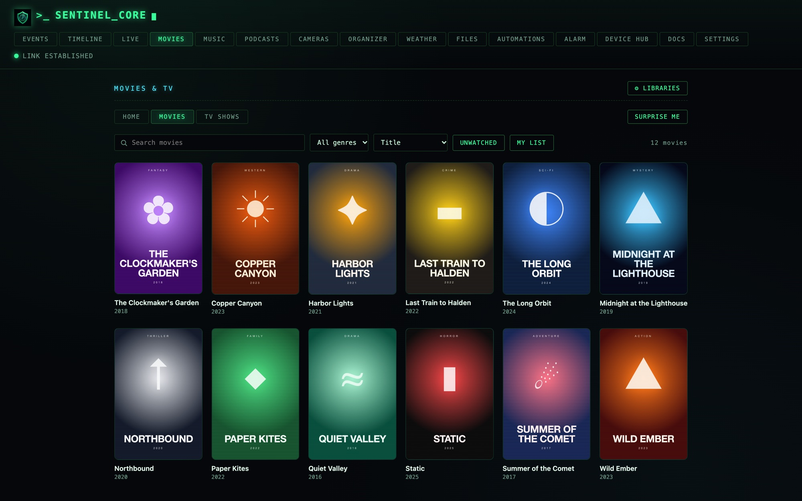 |

### Music & Podcasts

Albums, artists, playlists, genres, Daily Mixes and radio, synced lyrics, ratings and stats.
Playback carries on while you use other tabs, and **hands off between devices** ("paused on the
Mac, continue here"). Podcasts are downloaded and kept by the server, with Up Next, transcripts,
bookmarks, clips and a morning briefing.

| Album | Podcasts |
|---|---|
| 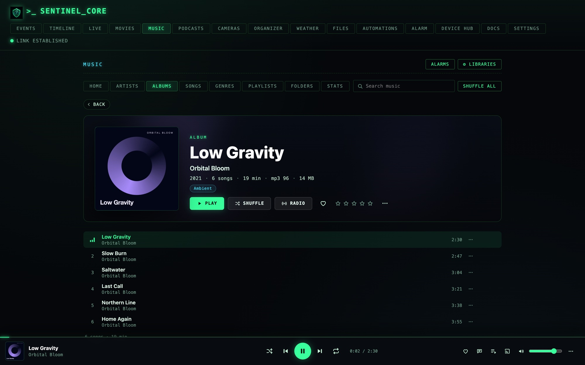 | 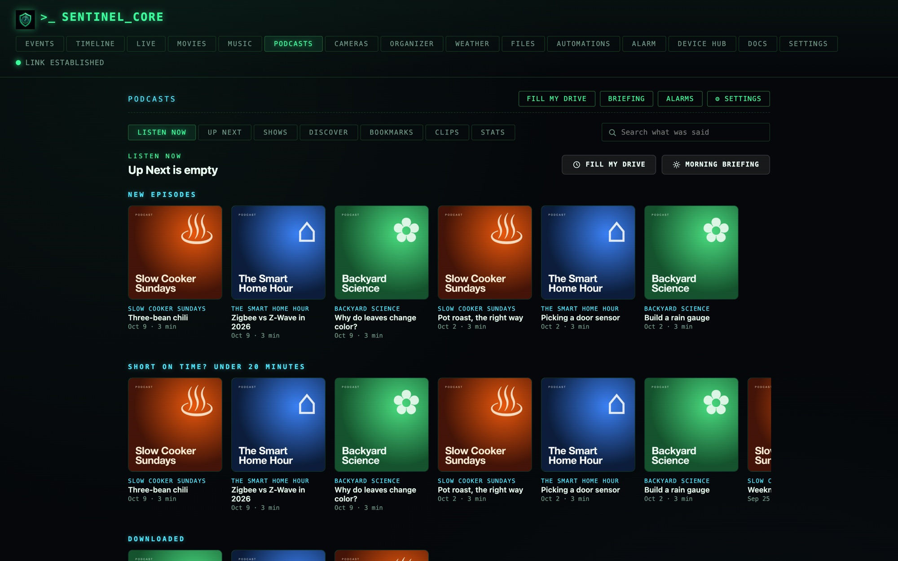 |

---

## Family Files

The household's photos, scans and documents, kept on the server and reachable from every app,
**backed up every night to as many drives as you like** (local disks or SFTP), with a nightly
duplicate check and a trash you can restore from.

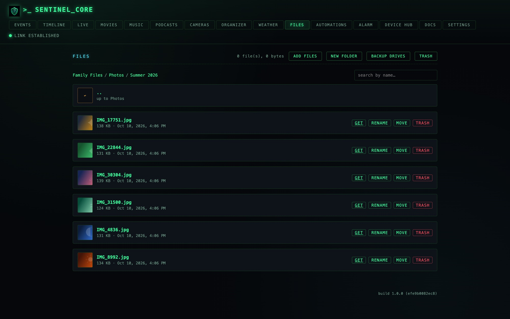

---

## Wall kiosk

Add `?kiosk=1` to the dashboard address on a wall-mounted tablet or a Raspberry Pi touch screen:
a home page with the time, weather, today's agenda, the alarm and live camera stills, big switches
for your devices, a bottom tab bar, swipe scrolling, an on-screen keyboard with swipe typing, and
a screen that dims itself and wakes on a tap.

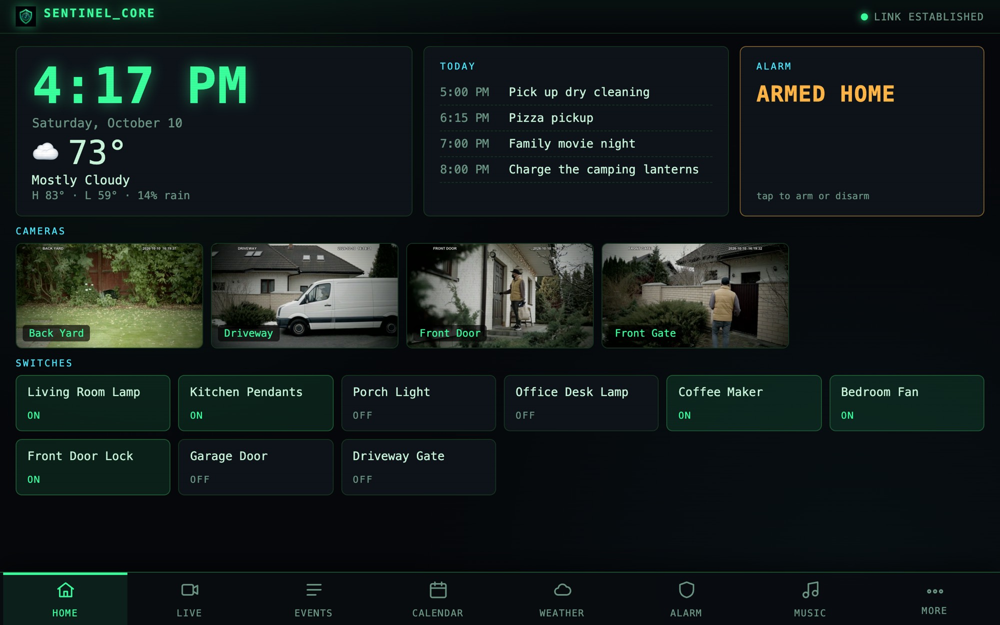

---

## The apps

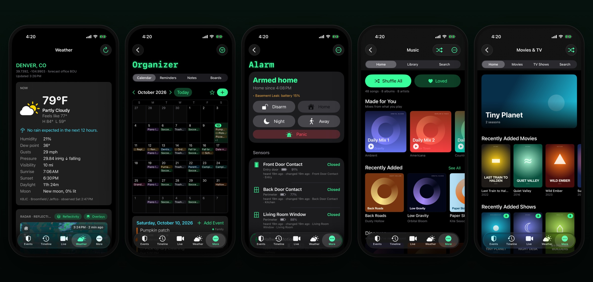

| App | Built with | Highlights |
|---|---|---|
| **iPhone & iPad** | SwiftUI | Every tab of the dashboard, push alerts, Home Screen widgets (Calendar, Reminders, Notes, Alarm), Quick Add widget, Siri App Intents, share extension, picture-in-picture for movies, the phone as a camera |
| **Mac** | SwiftUI (same project) | The iPhone app as a native Mac app, with the Quick Add widget and the Mac's own camera as a camera |
| **Apple TV** | SwiftUI for tvOS | Live cameras, Movies & TV, Music and Podcasts, Weather and the Organizer on the big screen, driven by the Siri Remote |
| **Android** | Kotlin, Jetpack Compose | Phones and tablets, push through Firebase, widgets, voice shortcuts, the phone as a camera (as a foreground service) |
| **Windows** | WPF, .NET 8, WebView2 | A desktop app for Windows 10 and 11 with live video and the PC's webcam as a camera |
| **Web** | Plain HTML, CSS and JavaScript | The full dashboard and admin, in any browser, including kiosk mode |

All apps find the server on the local network automatically, fall back gracefully between HTTPS
and HTTP, keep working away from home through the optional push relay, and share one build
number per release.

---

## Running it

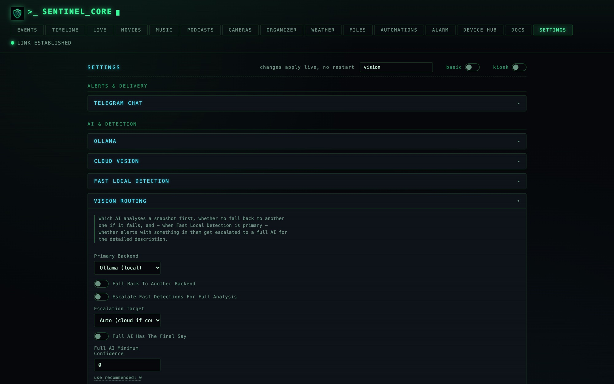

- **Everything is set from the dashboard.** Every option is in Settings, applies live, and is
  searchable. No config file editing is needed after install.
- **Accounts**: an admin account is created on first launch; viewers can be added with fewer
  permissions. Personal Organizer spaces follow each account.
- **Backups**: a full backup bundle on demand, and a nightly automatic export to a folder or an
  SFTP server.
- **Self-monitoring**: alerts when a camera, the AI, the queue or the internet connection
  stops working, when the server restarts after downtime, and when a lens gets a spider web.
- **Updates**: bundle installs update themselves overnight from signed releases.
- **HTTPS** with your own certificate authority, and an Internet Exposed Mode for reaching it
  from outside the house.
- **Runs on** Linux (systemd), macOS (launchd) or Windows (a service). It is built on .NET 10.

---

## How it fits together

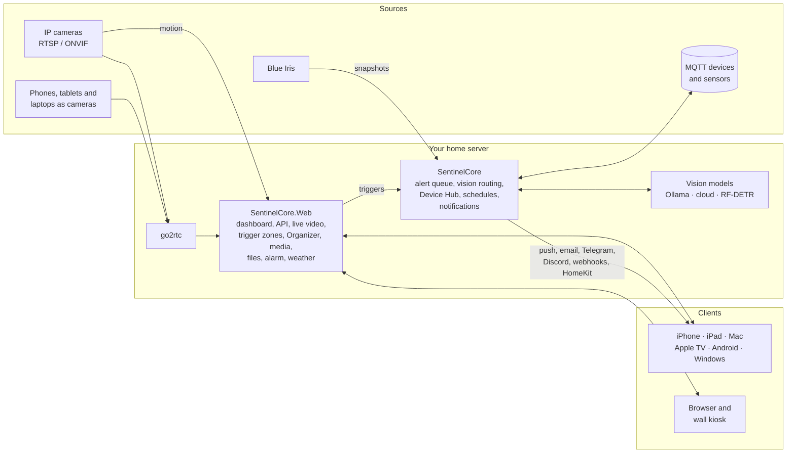

Two processes run side by side: **SentinelCore** (the alert bridge and smart-home engine, port
5080) and **SentinelCore.Web** (the dashboard and the API every app uses, port 3320, or 3443 over
HTTPS). Data stays in SQLite databases and folders on the server. A separate **push relay**
delivers notifications for installs that don't bring their own Apple or Firebase credentials.

---

## Where things are

| Folder | What it is | README |
| --- | --- | --- |
| `core/` | The server: AI vision engine, web dashboard and API, push delivery, push relay, licensing, HomeKit sidecar, and the movie-downloads installer (`core/downloads/`) | [core/README.md](core/README.md) |
| `ios/` | iPhone, iPad and Mac app, with Home Screen widgets (Calendar, Reminders, Notes, Alarm), the Quick Add widget (iPhone and Mac), a share extension, and the shared `OrganizerKit` package | [ios/README.md](ios/README.md) |
| `appletv/` | Apple TV app | [appletv/README.md](appletv/README.md) |
| `android/` | Android app for phones and tablets | [android/README.md](android/README.md) |
| `windows/` | Windows app (WPF) | [windows/README.md](windows/README.md) |
| `scripts/` | `bump-build.sh` (one build number for every app), `with-organizer-servers.sh` (throwaway test servers) | |
| `docs/` | Building and releasing, store distribution, privacy policy, and the screenshots in this README | |
| `branding/` | App icon masters | |

## Documentation

- **[docs/BUILDING.md](docs/BUILDING.md)**: tools, building and testing every part, releasing to
  TestFlight, Google Play and a production server, and the pitfalls hit so far. Start here.
- [core/docs/DEPLOYMENT.md](core/docs/DEPLOYMENT.md): installing and operating the server.
- [core/docs/USER_GUIDE.md](core/docs/USER_GUIDE.md): using the dashboard and its settings.
- [docs/STORE_DISTRIBUTION.md](docs/STORE_DISTRIBUTION.md): App Store Connect and Play Console
  setup, testers, and review preparation.
- [core/docs/PUSH_NOTIFICATIONS.md](core/docs/PUSH_NOTIFICATIONS.md) and
  [core/docs/PUSH_RELAY.md](core/docs/PUSH_RELAY.md): push providers and the relay.
- [core/docs/ORGANIZER_SYNC.md](core/docs/ORGANIZER_SYNC.md): the Organizer's sync protocol,
  shared by the server and every app.
- [core/docs/MOVIES.md](core/docs/MOVIES.md), [core/docs/MOVIE_DOWNLOADS.md](core/docs/MOVIE_DOWNLOADS.md)
  and [core/docs/MUSIC_AND_PODCASTS.md](core/docs/MUSIC_AND_PODCASTS.md): the Movies & TV, "+ Add"
  downloads, and Music & Podcasts APIs every app builds against.
- [docs/PRIVACY_POLICY.md](docs/PRIVACY_POLICY.md): what the apps, the server and the push relay
  send where.
- `core/docs/*_HANDOFF.md`: design notes and investigations for specific features.

## Quick start (developer)

```bash
# each line runs from the repository root
(cd core && dotnet build -c Release && dotnet test)                       # server
swift test --package-path ios/OrganizerKit                                # Organizer engine (Apple)
xcodebuild -project ios/SentinelCore.xcodeproj -scheme SentinelCore -destination 'platform=macOS' build
(cd android && ./gradlew assembleDebug testDebugUnitTest)                 # Android
dotnet build windows/SentinelCore.Windows.sln -p:EnableWindowsTargeting=true   # Windows (builds on a Mac too)
```

Details, prerequisites and the files that aren't in git are in
[docs/BUILDING.md](docs/BUILDING.md).

## License

Sentinel Core is **source-available**, not open source. The code is licensed under the
[PolyForm Noncommercial License 1.0.0](LICENSE.md): you may read it, run it for yourself and your
household, modify it and share those changes, for any noncommercial purpose. Selling it, offering
it as a service, or using it in a business needs a commercial license; see
[core/EULA.md](core/EULA.md) or contact support@nr5p.com.

Third-party components keep their own licenses; see
[core/THIRD-PARTY-NOTICES.txt](core/THIRD-PARTY-NOTICES.txt).
